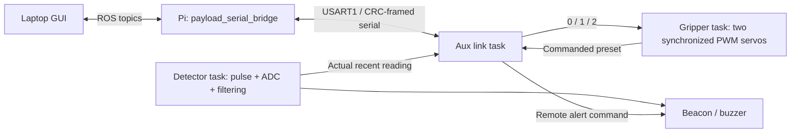

# Auxiliary ECU architecture

Current target: **STM32F103C8T6 Blue Pill**, two synchronized servos, custom framed UART to the Pi. The earlier F411/three-servo guides are obsolete. See [requirements](SYSTEM_REQUIREMENTS.md) and the workspace testing guide at `Auto/TestingGuide.md`.

## Responsibilities and data flow

Aux owns detector timing, acquisition/filtering, paired-servo PWM and local indicators. The Pi owns ROS message conversion and serial reconnection. Mobility control, IMU/GPS, localization and autonomy are outside Aux. Detection never automatically moves the servo in the physical manual profile.

Legacy `microros_*` filenames contain the existing custom protocol, not XRCE. Use `payload_serial_bridge`; do not attach a micro-ROS agent to this UART.

## Hardware and timing

| Function | Mapping | Current configuration |
|---|---|---|
| System | F103C8T6, 8 MHz HSE | 72 MHz; 64 KB flash / 20 KB SRAM |
| Two servos together | PB6 / TIM4 CH1 and PB7 / TIM4 CH2 | 50 Hz, 1 µs ticks, PSC 71 / ARR 19999 |
| Detector excitation | PB0 | 70 µs pulse, then 20 µs blanking |
| Detector acquisition | PA1 / ADC1 IN1 | 12 MHz ADC, eight samples; conversion waits bounded using TIM2 |
| Detector timer | TIM2 | 1 MHz, 16-bit; wrap-safe subtraction |
| Pi transport | PA9 TX / PA10 RX, USART1 | 921600 baud, separate 3.3 V USB–UART adapter, crossed TX/RX and common ground |
| Serial DMA | DMA1 CH4 TX / CH5 RX | Normal TX, circular RX |
| Time bases | TIM3 / SysTick | HAL millisecond clock / FreeRTOS tick |
| Indicators | PB12 buzzer; PB13/14/15 LEDs; PC13 heartbeat | Existing payload indicator logic |
| Debug | PA13 / PA14 | ST-Link SWDIO / SWCLK |

PB7 is the second servo output; PB8 is not a servo output. Both channels receive the same pulse width. Mirrored mechanical mounting may require independent calibration before loading the mechanism. Servo neutral/open/close presets default to 1500/1000/2000 µs; confirm travel limits against the actual mechanism before powered acceptance. Supply servo power separately from logic as appropriate, retain common ground, and confirm the detector analog input stays within the ADC range.

## Firmware organization and resources

| Layer | Source / responsibility |
|---|---|
| Board configuration | `STM32_Auxiliary.ioc`, F1 HAL configuration, peripheral sources, F103 startup/linker files |
| BSP | `Core/BSP`: paired-servo driver, detector driver and indicators |
| Tasks | `Core/Tasks`: detector at nominal 20 Hz; event-driven gripper; link loop nominal 10 ms |
| Serial framing | `Core/Middleware/microros`: UART DMA, parsing, CRC and topic dispatch |
| ROS boundary | Pi `payload_serial_bridge.py` in the ROS hardware package |

FreeRTOS heap is 10 KB. Detector/gripper/link stack allocations are 1024/768/1536 bytes; measure high-water marks during acceptance. The CMSIS wrapper requires 56 priority levels. RTOS objects are initialized after the kernel, and application task implementations are external to the generated task setup.

Old F4 vendor libraries/linker scripts remain excluded historical source; active builds select F1 HAL, the Cortex-M3 RTOS port and `STM32F103C8TX_FLASH.ld`. Sources for board initialization and application behavior are authoritative: compare CubeMX regeneration in a separate folder before replacing custom code.

## Serial and ROS contract

Frames are `AA 55`, topic byte, little-endian 16-bit length, payload, and CRC16/MODBUS over topic + length + payload. Payload command lengths and values are checked.

| ID | Direction | ROS interface / payload |
|---|---|---|
| `0x10` | Aux → Pi | `/metal_detector/reading`, little-endian float32, normalized 0–1, nominal 20 Hz after actual recent samples |
| `0x11` | Aux → Pi | `/gripper/status`, signed int8, nominal 10 Hz; 0 neutral / 1 open / 2 close / −1 unknown |
| `0x12` | Aux → Pi | `/payload/heartbeat`, one byte 0/1, nominal 1 Hz |
| `0x20` | Pi → Aux | `/gripper/command`, exactly one byte 0/1/2 |
| `0x21` | Pi → Aux | `/beacon/alert`, exactly one byte 0/1 |

Status describes commanded PWM state, not position measurement or verified grasp. The GUI and bridge reject unavailable/stale-link commands instead of storing them for reconnect. A UART-open flag inside firmware is not proof that the Pi is alive.

## Build and current evidence

From `Aux/`, configure `cmake -S . -B build -DCMAKE_TOOLCHAIN_FILE=cmake/arm-gcc.cmake`, then run `cmake --build build`, or import the existing CubeIDE project. ARM GNU tools are required. Outputs are `build/STM32_Auxiliary.elf`, `.bin` and `.map`.

Dependencies are ST F1 HAL v1.1.10, CMSIS F1 v4.3.4 and the FreeRTOS CM3 port V10.3.1 matching the bundled kernel; licenses/notices remain with their sources. CMake compile/link passed on 16 October 2026, using 25,640 bytes flash and 16,904 bytes static RAM. CubeIDE/CubeMX behavior, runtime stack margin, flashing, signal timing and real payload operation still require hardware evidence.
